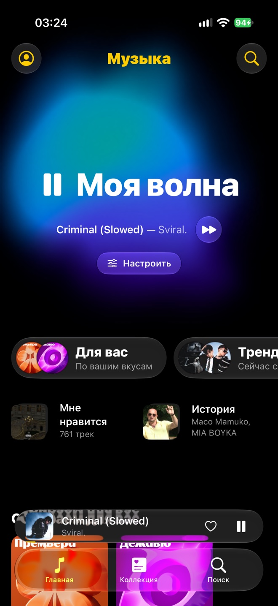
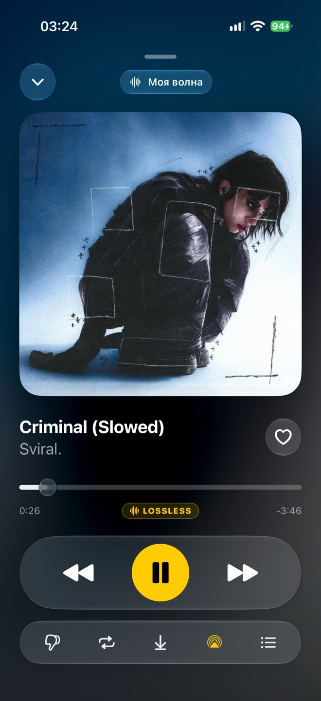
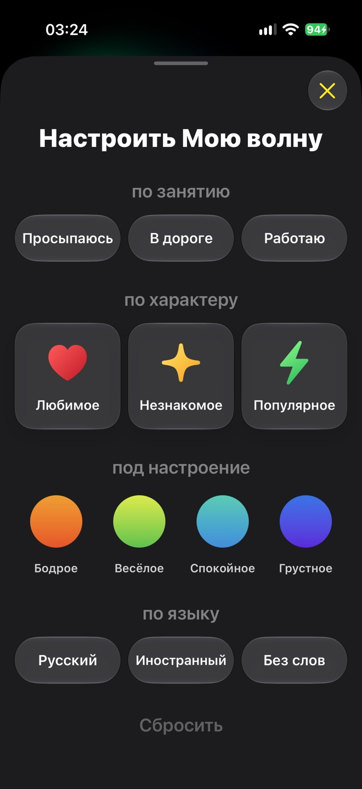
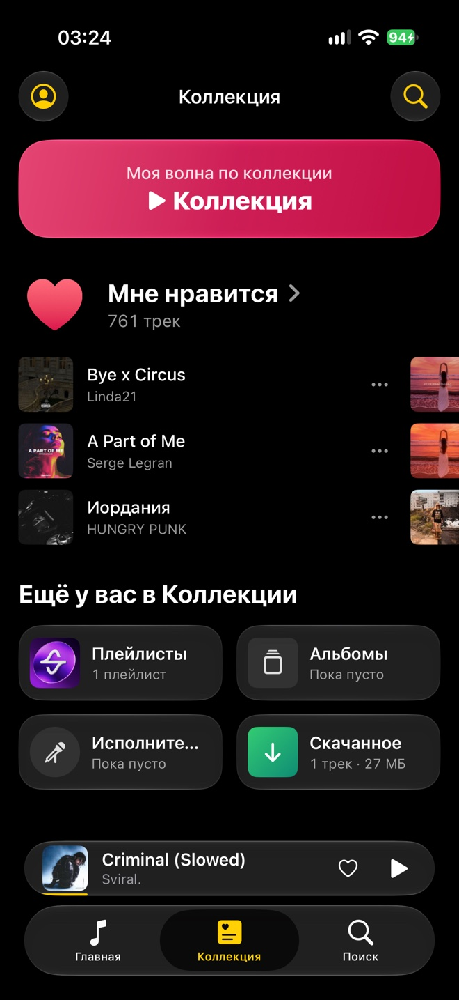
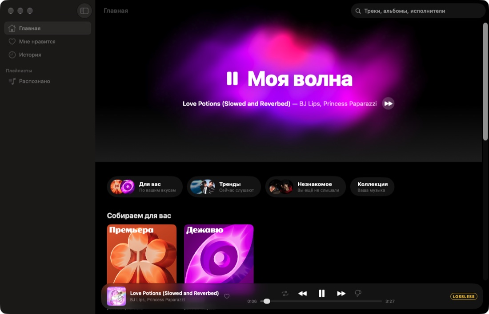

# ymusic

Unofficial Yandex Music client: a Rust core with native SwiftUI apps for iPhone (iOS 26,
Liquid Glass) and a minimal client for Mac.

**English** · [Русский](README.ru.md)

> Not affiliated with Yandex. You need your own account; full-length tracks, high quality and
> offline files are only served to accounts with an active Plus subscription, and the client
> does not work around that. The app UI is in Russian.

<p align="center">
  
  
  
  
</p>
<p align="center">
  
</p>

## Features

- Home with My Wave (including tuning by activity, character, mood and language), mixes,
  liked tracks, playlists, history, search.
- Selectable quality: 64 / 192 / 256 kbit/s AAC and lossless FLAC, set separately for Wi-Fi,
  cellular and downloads.
- Offline: download tracks to the device, a "downloaded only" mode, a cache of what you played.
- Resilient on bad networks: progressive streaming with resume, automatic quality drop on a
  weak link and recovery once the link is healthy again.
- An animated Metal wave that costs next to nothing: about 2% of one core when idle and about
  0.1% while playing in the background (iPhone 16 Pro).

## Layout

| Directory | Contents |
|---|---|
| `core/` | Rust: a port of [MarshalX/yandex-music-api](https://github.com/MarshalX/yandex-music-api), exposed through UniFFI |
| `ios/` | iPhone app; `ios/YaMusic/Core` is the playback, cache and settings core shared with the Mac app |
| `mac/` | Mac app |
| `scripts/` | Build, device install, measurement |

Architecture notes are in [CLAUDE.md](CLAUDE.md).

## Building

Requires Xcode 27, Rust with the `aarch64-apple-ios`, `aarch64-apple-ios-sim` and
`aarch64-apple-darwin` targets, and [XcodeGen](https://github.com/yonaskolb/XcodeGen).

```sh
core/build-xcframework.sh                 # core → ios/Frameworks/YmCore.xcframework + Swift bindings
echo 'YM_TEAM_ID=XXXXXXXXXX' > local.env  # your Apple Developer Team ID
scripts/deploy-ios.sh --launch            # build and install on a connected iPhone
scripts/build-mac.sh --run                # build and run on the Mac (Debug)
scripts/install-mac.sh --open             # Release build into /Applications (Apple silicon only)
```

Sign in with Yandex OAuth inside the app.

## License

LGPL-3.0, same as the upstream library (see [LICENSE](LICENSE)).
